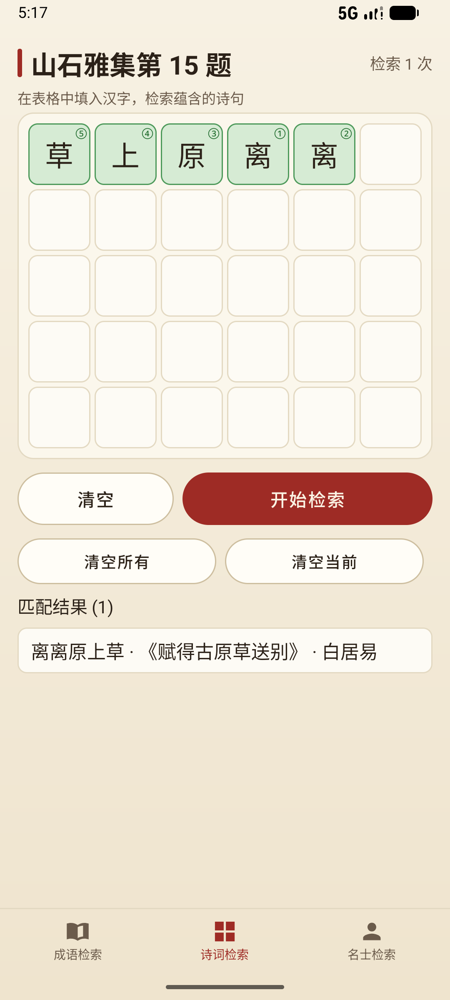
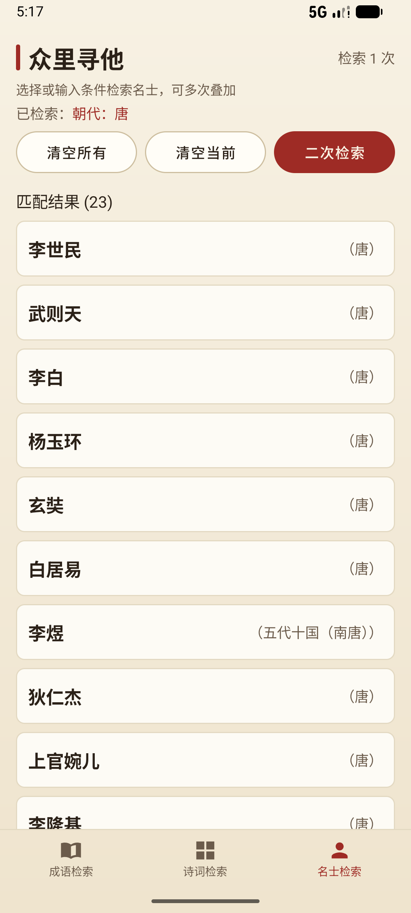
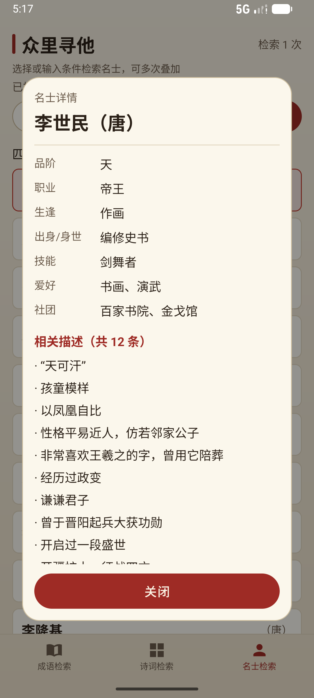
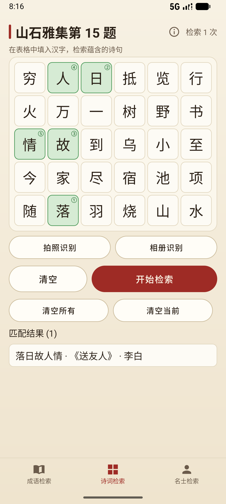
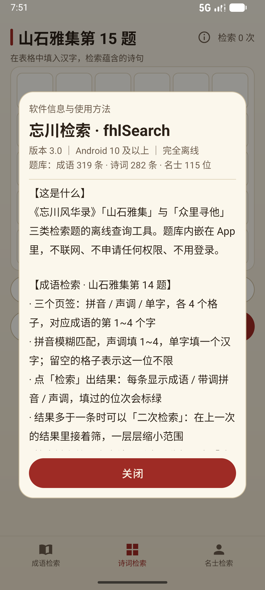
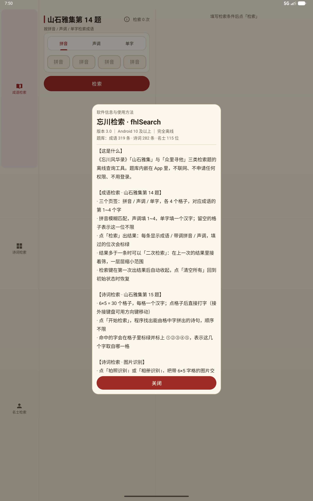
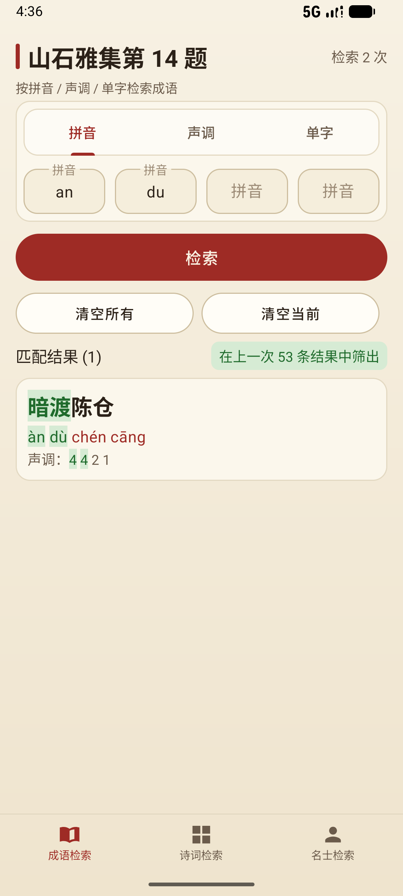
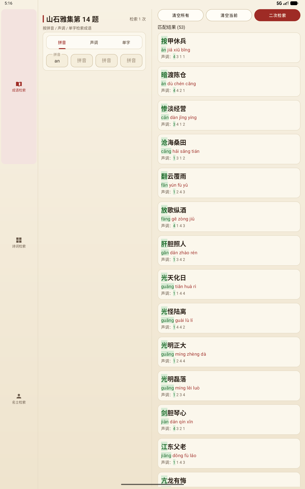

# 忘川检索 fhlSearch · Android 版

《忘川风华录》「山石雅集」与「众里寻他」三类检索题的**离线查询 App**。

**Kotlin + 传统 XML 布局，题库内嵌，完全离线：不联网、不要任何权限，支持 Android 10（API 29）及以上手机与平板。**

> 非商业同人工具，仅供个人学习交流。与网易及《忘川风华录》官方无关联。

界面与 Windows 版《忘川检索》共用同一套设计规范（宣纸底 + 朱砂 + 描金）。


---

## 快速开始

直接下载 **[`dist/fhlSearch.apk`](dist/fhlSearch.apk)**（约 44 MB —— 其中约 30 MB 是内嵌的中文 OCR 模型），
传到手机 / 平板上点一下安装即可。

> - 首次安装需要在系统里允许「安装未知应用」（Android 会自己弹提示）。
> - 装完是一个**独立的离线 App**，没有广告、没有账号、不需要联网。
> - 卸载就是普通的卸载，不会残留任何东西。

---

## 三大模块

| 模块 | 大标题 | 内容 |
| --- | --- | --- |
| 成语检索 | 山石雅集第 14 题 | 319 条成语，拼音 / 声调 / 单字三种模式，各 4 个格子 |
| 诗词检索 | 山石雅集第 15 题 | 282 条五言诗句，6×5 字格填字，自动找出能组成的诗句 |
| 名士检索 | 众里寻他 | 115 位名士，9 种条件（朝代 / 爱好 / 社团 / 品阶 …）叠加筛选 |

> ⚠️ **关于「众里寻他」**：「众里寻他」活动近期没有复刻，本题库依据的是旧版本的规则与
> 玩家整理的资料，**实际功能可能存在偏差或问题，当前仅供参考**。后续相关活动正式上线后，会据此再作调整。

几个细节：

- **成语**：拼音模糊匹配，声调、单字精确匹配；留空的格子表示"这一位不限"。命中的位次会在**成语 / 带调拼音 / 声调**三处同时标绿，一眼看出命中第几个字。
- **诗词**：手指点某一格 → 出现朱砂红框与光标，输入法打进去的字就落在那格（接外接键盘时可用 **↑ ↓ ← →** 移动、Tab 右移、Backspace 清除）。命中后，用到的格子标绿并标上 **①②③④⑤**，表示这几个字分别取自哪一格；点结果里的任意一条可以切换高亮组合。
- **名士**：朝代 / 爱好 / 社团 / 品阶 用**居中滚轮**挑，其余 5 种是**模糊输入**（忽略空格标点）。点结果里的任意一行弹出该名士详情（全部属性 + 题库里属于他的所有相关描述）。右上角有**检索次数**计数。

| 诗词字格 | 名士检索 | 名士详情 |
| --- | --- | --- |
|  |  |  |

---

## 📷 图片识别（v3.0 新增）：诗词检索不用一个个敲字

字格下面多了两个键：**拍照识别** 和 **相册识别**。把带 6×5 字格的题目截图（或照片）丢进去，
程序会自己找出字格、认出 30 个汉字填进格子，**然后直接开始检索** —— 就是搜题软件那种感觉。



| 步骤 | 做什么 |
| --- | --- |
| 1 | 读图并按长边缩到 2200 以内，**按 EXIF 摆正**（手机照片常"躺着"存） |
| 2 | 找"亮底大面板"，自动忽略长截图的黑边与状态栏；**面板与整图各试一次，谁能切出 5×6 用谁** |
| 3 | 用暗像素投影（Otsu 阈值）切出 6 列 × 5 行 |
| 4 | **逐格**抠图：按这格自己的底色判极性（深底浅字自动反相）、2%/98% 分位拉对比、裁到墨迹、放大到 240px、锐化 |
| 5 | 30 格拼成一张白底大图（格间距 80px），一次性交给 **ML Kit 中文识别** |
| 6 | 识别结果按包围盒映射回格子；第一趟没填满就换"原图风格"再认一遍，**取并集** |
| 7 | 填格 → 自动检索 → 出诗句 |

- **完全离线**：模型 `com.google.mlkit:text-recognition-chinese` 已随 apk 打包，不联网、不下载、不依赖 Google Play 服务，**图片不出手机**。
- **不申请权限**：拍照走系统相机（`TakePicture` + `FileProvider` 授权的缓存文件），选图走系统照片选择器（`PickVisualMedia`），因此**清单里一个权限都没有**。
- **认错了可以直接改**：格子本来就是可编辑的，改掉认错的字再点「开始检索」；若没凑出诗句，会提示"识别结果可能有错，对照截图改一下"。
- 实测 6 张样例图（含手机拍照、小红书长截图、504×393 的小图）：**5 张拍进去直接出诗句**，填充 27~30 / 30 格。

> 提高识别率：字格要完整（连边框一起）、尽量用原图别用转发压缩图、别拍得太斜；深色格子配浅色字也能认。

---

## ⓘ 信息面板（v3.0 新增）

每个页面**大标题右边**都有一个圆圈里带 i 的小图标，点开是屏幕正中的信息卡片：
软件名 / **版本号（从安装包读）** / 题库条数 / 三大模块用法 / 图片识别怎么拍 / 题库来源与版权 / 隐私说明。

| 信息面板（手机） | 信息面板（平板） |
| --- | --- |
|  |  |

---

## 「检索」与「二次检索」

这是本工具的核心交互，一层层把范围缩小：

| 动作 | 行为 |
| --- | --- |
| **检索** | 在全库里查当前条件 |
| **二次检索** | **在上一次的结果里接着筛**，点下去**当场出结果**（不用再点一次「检索」）；结果标题旁会显示"在上一次 N 条结果中筛出" |
| **清空当前** | 退回上一次的结果（**你填的条件会保留**，方便接着改） |
| **清空所有** | 全部复位，检索次数归零 |

**检索键会在第一次查出结果后自动收起**（此后要接着筛就用「二次检索」，把屏幕让给结果）；
点「清空所有」、或「清空当前」退到最后一层之下时，它会自动回来。
一次都没命中（0 条）时它会保持显示，免得条件写错后没法直接重搜。

| 二次检索（范围提示条） | 平板双栏 |
| --- | --- |
|  |  |

---

## 目录结构

```
Android/
├── app/                          Android 应用模块（源码都在这里）
│   ├── build.gradle.kts
│   ├── proguard-rules.pro
│   └── src/
│       ├── main/
│       │   ├── AndroidManifest.xml    注意：一个权限都没申请
│       │   ├── assets/                内嵌题库 JSON（由 data/ 里的 Excel 生成）
│       │   ├── java/com/wangchuan/fhlsearch/
│       │   │   ├── FhlApp.kt          入口：后台读题库
│       │   │   ├── MainActivity.kt    外壳：手机底部三格 / 平板左侧三格导航 + 系统栏避让
│       │   │   ├── data/Tiku.kt       题库解析
│       │   │   ├── logic/SearchLogic.kt   三大模块的检索算法（纯函数，好测）
│       │   │   ├── ocr/PoemOcr.kt     **图片识别流水线**：面板检测 → 投影切格 → 逐格归一化 → 拼板 → 映射回格子
│       │   │   ├── ocr/OcrEngine.kt   ML Kit 中文识别的封装（把连读的整行字切成单字位置）
│       │   │   ├── ui/                三个模块的界面：Chengyu / Shici / Mingshi + 共用 ResultView
│       │   │   ├── ui/sheet/          居中弹窗：滚轮 / 输入 / 名士详情 / **信息面板** / 识别等待
│       │   │   ├── widget/            自绘控件：6×5 字格、滚轮选择器
│       │   │   └── util/              拼音标调、Toast、**图片加载（降采样 + EXIF 摆正）**
│       │   └── res/                   布局 / 配色 / 文案 / 图标（含 layout-sw600dp 平板版式）
│       └── test/java/...              单元测试（20 项）
├── gradle/wrapper/               Gradle Wrapper（已内置，克隆下来直接能编译）
├── gradlew / gradlew.bat / build.gradle.kts / settings.gradle.kts / gradle.properties
├── 一键重新打包apk.bat           Windows 上双击即可出包
├── dist/fhlSearch.apk            发布产物（已签名，可直接安装）
├── data/                         题库源文件（三份 Excel）
├── docs/
│   ├── 需求梳理.md               需求、决策与逐轮改动记录（最完整的一份）
│   ├── 使用说明.md               给使用者看的说明
│   ├── 界面文案与配色规范.md      全部文案与配色取值
│   ├── 需求原文/                 最初的三份需求文本
│   ├── icons/                    图标导出件与设计方案对比
│   ├── screenshots/              README 用的截图
│   └── dev/                      开发过程存档（构建环境验证报告、现状核查与交接说明）
├── tools/                        开发与验证脚本（Python，见下）
├── keystore.properties.example   签名配置示例（真名文件不进版本库）
├── LICENSE / NOTICE.md / CHANGELOG.md
```

---

## 编译

**环境要求**：JDK 17 及以上 + Android SDK（需要 `platforms;android-37`、`build-tools;36.0.0`）。
Gradle Wrapper 已内置（9.8.1），不用另外装 Gradle。

**用 Android Studio**：直接 `File → Open` 打开本目录，等它同步完，点绿三角运行。
（`local.properties` 里 SDK 路径 Android Studio 会自己生成。）

**用命令行**：

```bat
:: debug 包（产物 app\build\outputs\apk\debug\app-debug.apk）
gradlew.bat :app:assembleDebug

:: release 包
gradlew.bat :app:assembleRelease

:: 跑单元测试（20 项）
gradlew.bat :app:testDebugUnitTest
```

**最省事**：Windows 上双击根目录的 **`一键重新打包apk.bat`** ——
它会自己找 JDK、把 `data/` 里的题库转成内嵌数据、编译、再把 apk 收进 `dist/`。

### 签名（可选）

仓库里**不包含**签名密钥。没有密钥也能编译，只是产物叫 `app-release-unsigned.apk`，装不上手机。
要出自己的签名包：

```bat
:: 1. 生成密钥库（只需做一次，两个口令自己定）
keytool -genkeypair -v -keystore keystore\fhlsearch-release.jks ^
        -alias fhlsearch -keyalg RSA -keysize 2048 -validity 10000

:: 2. 把 keystore.properties.example 复制成 keystore.properties 并填好口令
:: 3. 重新打包
gradlew.bat :app:assembleRelease
```

`keystore.properties` 与 `*.jks` 都已在 `.gitignore` 里，不会被误提交。

---

## 题库

题库是三个 Excel，放在 `data/`：

| 文件 | 内容 |
| --- | --- |
| `成语检索.xlsx` | 319 条成语（成语 + 4 个拼音 + 4 个声调） |
| `诗词检索.xlsx` | 282 条五言诗句（诗句 + 诗名 + 作者） |
| `名士检索.xlsx` | 115 位名士（朝代 / 品阶 / 职业 / 生逢 / 出身 / 技能 / 爱好 / 社团 / 描述） |

改完题库后：

```bat
python tools\build_tiku.py          :: xlsx → app\src\main\assets\tiku_*.json
gradlew.bat :app:assembleRelease    :: 重新编译
```

或者直接双击 `一键重新打包apk.bat`（已包含这一步）。
`data/` 里没有 Excel、或者机器上没有 Python 时，脚本会自动跳过转换，
直接沿用仓库里已经生成好的 JSON —— 所以**不装 Python 也能出包**。
题库目录想放到别处，设环境变量 `FHL_TIKU_SRC` 指向那个目录即可。

题库共 **135 KB**，全部内嵌进 apk，运行时零 IO、零联网。

**题库来源**：题库来源于微博 **@蓝在寻**（原整理者），本仓库只做了格式转换，
不对这部分内容主张任何权利；详见 [`NOTICE.md`](NOTICE.md)。

---

## 技术要点

| 项 | 取值 |
| --- | --- |
| 语言 / 界面 | Kotlin + 传统 XML 布局（ViewBinding），刻意不用 Compose |
| 版本 | `minSdk 29`（Android 10）· `targetSdk 37` · **`versionName 3.0`** |
| 构建 | AGP **9.4.1**（内置 Kotlin 支持，不能再单独 apply kotlin-android 插件）+ Gradle Wrapper 9.8.1 |
| 包名 | `com.wangchuan.fhlsearch` |
| 权限 | **无**。清单里连 `INTERNET` 都没有（拍照/选图都走系统托管的通道），物理上不可能联网 |
| 图片识别 | **ML Kit 中文文字识别（内置模型版）** + 自研"面板检测 → 投影切格 → 逐格归一化 → 拼板 → 坐标映射"流水线 |
| 安装包 | 44.25 MB（`arm64-v8a` + `armeabi-v7a` + `x86_64`；OCR 的 `.so` 每个 ABI 约 10 MB） |
| 代码量 | 19 个 Kotlin 源文件（约 3100 行）+ 68 个 XML（约 1900 行） |
| 适配 | 手机单栏 / 平板双栏（`layout-sw600dp`），横竖屏、刘海与手势条安全区都做了避让；系统字号放到 2 倍也不裁字 |

几个实现上的取舍：

- **检索算法是纯函数**（`logic/SearchLogic.kt`），不碰 Android API，所以能直接在 JVM 上跑单元测试。
- **模糊匹配用的归一化字段在打包期就算好**（`build_tiku.py`），运行时不再处理，既省电又保证和 Windows 版行为一致。
- **模糊、声调、单字三种模式的输入框共用同一批控件**，切换模式时各自记住自己填过的内容，不会互相覆盖。
- **诗词字格的选中框与输入焦点强制同步**：点哪一格焦点就去哪一格，避免"看着选中了、打出来的字却进了上一格"。
- 弹窗（滚轮 / 输入 / 名士详情）统一走 `CenteredDialogFragment`，宽度取屏幕 86% 且不超过 440dp，保证在手机与平板上都居中且不撑破。

---

## 验证

### 单元测试与静态检查

| 项 | 结果 |
| --- | --- |
| `gradlew :app:testDebugUnitTest` | **20 项全绿**（检索算法 14 + 拼音标调 6） |
| `python tools/validate_res.py` | **600 处资源引用全通过**（布局 / drawable / 字符串 / 样式） |

### 设备回归

在 Android 17 手机（1080×2400）、Android 17 平板（1600×2560）、Android 10 手机（API 29）三台模拟器上，
用**正式签名包**跑过全流程与全部回归脚本：

| 脚本 | 覆盖内容 | 结果 |
| --- | --- | --- |
| `drive_app.py` | 三个模块全流程 + 抓图 + 崩溃检查 | 通过，无崩溃 |
| `test_cy_search_btn.py` | 成语「检索键」显隐 9 个状态 | 9/9 |
| `test_ms_search_btn.py` | 名士「检索键」显隐 10 个状态 | 10/10 |
| `test_cy_second_search.py` | 成语二次检索 9 项（含"输入框不被清空"） | 9/9 |
| `test_shici_focus.py` | 字格选中框与输入焦点是否同步 9 项 | 9/9 |
| `test_ms_dialogs.py` | 三个弹窗是否屏幕居中 | 通过 |
| `test_font_scale.py` | 系统字号 2 倍压力测试 | 通过 |
| `test_ocr.py` | **图片识别**：6 张样例图逐张识别、填充格数、是否直接出诗句 | 5/6 出诗句，填充 27~30/30 |
| `test_ocr_gallery.py` | 图片识别的**系统通道**：照片选择器 → 识别 → 出结果；相机能否拉起 | 通过（Android 10 模拟器的文件选择器/相机应用本身不可用，该项跳过） |
| `test_info.py` | 三个模块的**信息面板**：弹出、居中、版本号、题库统计、用法正文、关闭 | 通过 |

### tools/ 里都有些什么

| 脚本 | 干什么 |
| --- | --- |
| `build_tiku.py` | 三份 Excel → 内嵌 JSON 题库 |
| `reference_logic.py --selftest` | 三大模块检索语义的基准自测（不依赖 Android） |
| `validate_res.py` | 资源 / XML / 引用静态校验 |
| `audit_pinyin.py` | 全题库拼音标调审计（带调拼音有没有标错、标漏） |
| `drive_app.py` | 在模拟器上走全流程、抓图、查崩溃 |
| `test_*.py` | 上面那批回归脚本 |
| `measure_layout.py` | 量关键控件的真实坐标（改布局时用） |
| `gen_app_icon.py` / `export_app_icon.py` / `check_adaptive_icon.py` | 生成与导出图标（朱砂圆印 + 自适应图标） |
| `setup_gradle_wrapper.py` | 铺 Gradle Wrapper（本机没有 Android Studio 时的备用手段） |

> 这些脚本全部按"脚本所在位置"推算项目根目录，克隆到任何路径都能直接跑；
> 需要设备的脚本用 `adb`，默认设备号写在各脚本头部，可命令行覆盖。

---

## 版权与免责

- 这是一个**非商业同人工具**，仅供个人学习、研究与交流使用，**没有广告、赞助或任何收费入口**。
- 《忘川风华录》及其全部游戏内容、名词、角色、设定、文本，版权归 **网易（NetEase）** 所有。
- 程序代码按 MIT 协议开源；**题库数据不在 MIT 覆盖范围内**，见 [`NOTICE.md`](NOTICE.md)。
- 题库由第三方整理，可能存在错漏，不保证与游戏内实际内容一致。
- 程序**不含任何游戏美术 / 音频 / 立绘资源**，只有检索用的纯文本条目；图标是自行绘制的朱砂圆印。
- **如果权利人认为本仓库或本程序有不妥之处，请在本仓库的 Issues 页面留言，或联系作者，
  我会在收到通知后立即核实并移除，无需事先协商。**
- 请支持正版游戏。

---

## 许可

代码以 MIT 协议开源，详见 [LICENSE](LICENSE)；
**题库数据不在 MIT 授权范围内**，版权归其整理者，详见 [NOTICE.md](NOTICE.md)。

版本变更见 [CHANGELOG.md](CHANGELOG.md)。
