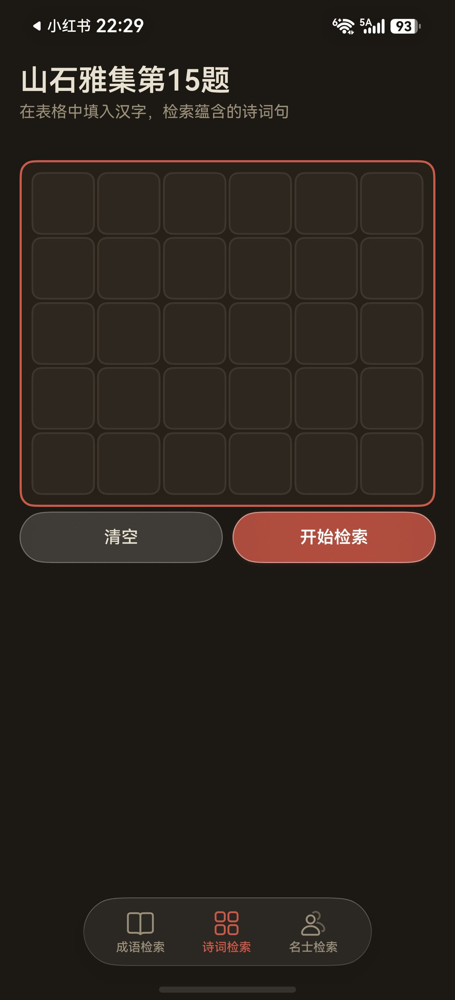
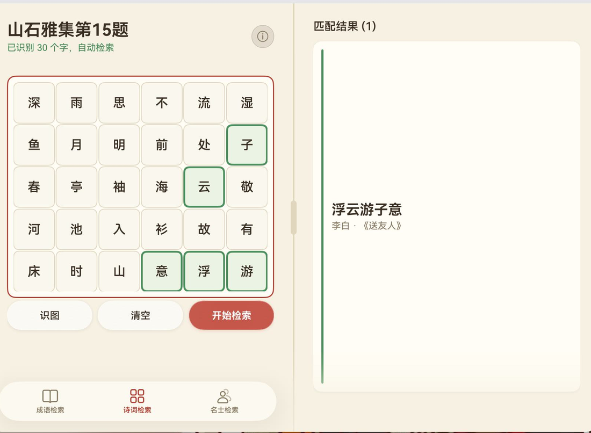
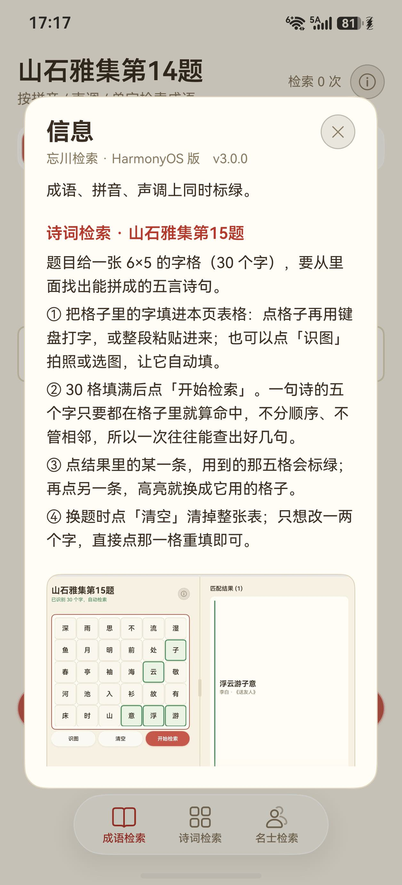
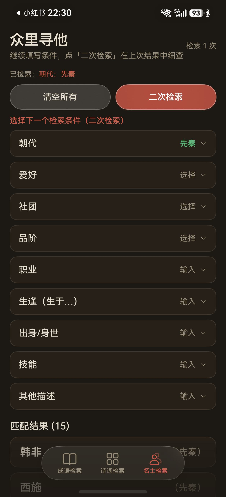
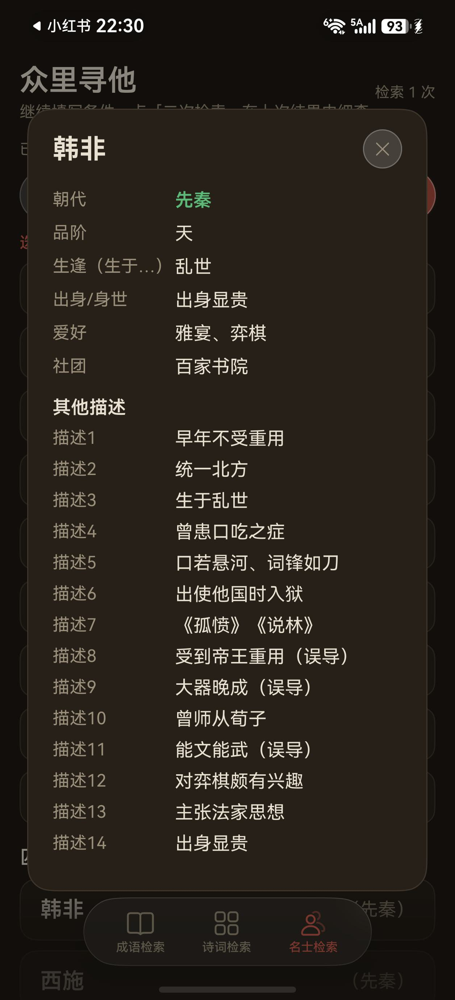
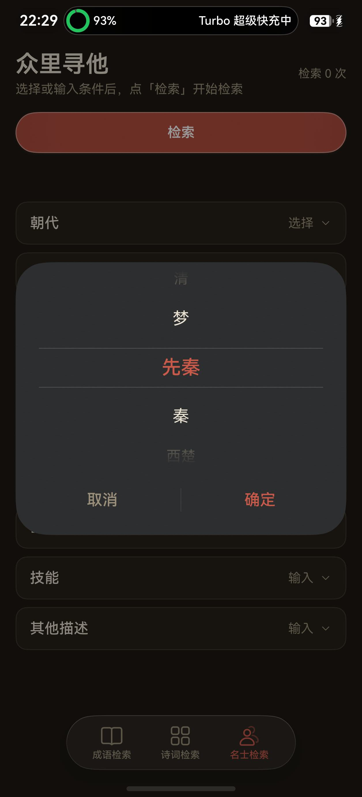
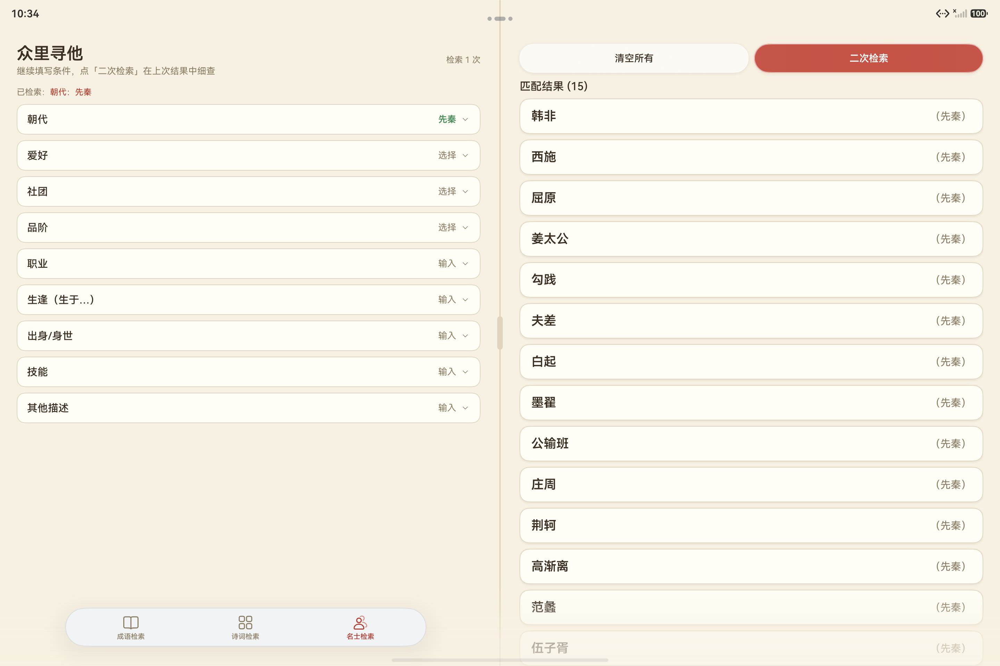

# 忘川检索 fhlSearch · HarmonyOS 版

《忘川风华录》「山石雅集」与「众里寻他」三类检索题的**离线查询 App**。

**ArkTS + ArkUI（Stage 模型），题库内嵌，完全离线：不联网、不要多余权限，支持 HarmonyOS NEXT（API 24 / 6.1.1）手机与平板。**

> 非商业同人工具，仅供个人学习交流。与网易及《忘川风华录》官方无关联。

界面与 Windows / Android 版共用同一套设计规范（宣纸底 + 朱砂 + 描金），底部导航用的是 HarmonyOS 官方 HDS 的**「沉浸光感」悬浮页签栏**。

| 成语检索 | 诗词检索 |
| --- | --- |
|  |  |

| 识图填字（v3 新增） | 信息页（v3 新增） |
| --- | --- |
|  |  |

> v3.0.0 起：诗词检索可以**拍照 / 选图自动填表**；大标题右边的「ⓘ」是应用说明与用法（含样图）。

---

## 快速开始

### 方式一：下载现成的（未签名 hap）

**[`dist/fhlSearch.hap`](dist/fhlSearch.hap)** —— 约 1 MB，**未签名**，适用于 HarmonyOS NEXT（API 24 / 6.1.1）手机与平板。

华为的安装包**必须签名**才能进入设备，未签名的 hap 直接点开是**装不上的**，需要侧载：

1. **准备一个华为开发者账号** —— 在[华为开发者官网](https://developer.huawei.com/)自行注册，并按页面指引完成开发者认证（免费）
2. **开启开发者模式** —— 设置 → 关于本机 → 连点「版本号」7 次，再到「开发者选项」里打开 **USB 调试**
3. **侧载安装** —— 用 **小白调试助手**、**DevEco Studio** 或同类工具连上设备，选中这个 hap 安装（工具会自行完成签名环节）

### 方式二：自己编译（可自定义签名）

1. 装 **DevEco Studio**（本工程用 26.0.0.621 开发，SDK 6.1.1(24)）
2. `File → Open` 打开本目录（`Harmony/`）
3. `File → Project Structure → Signing Configs` 勾选 **Automatically generate signature**（用你自己的华为开发者账号，DevEco 会自动生成证书与 profile）
4. 手机 / 平板打开「开发者模式 + USB 调试」，连上后点绿三角运行

命令行出包（产物 `entry/build/default/outputs/default/entry-default-signed.hap`）：

```bat
set DEVECO_SDK_HOME=<你的 DevEco 安装目录>\sdk
"<你的 DevEco>\tools\node\node.exe" "<你的 DevEco>\tools\hvigor\bin\hvigorw.js" ^
    assembleHap --mode module -p product=default -p buildMode=debug --no-daemon
```

装到设备：`hdc install -r entry\build\default\outputs\default\entry-default-signed.hap`（`hdc` 在 DevEco 的 `sdk\default\openharmony\toolchains\` 下）

---

## 三大模块

| 模块 | 大标题 | 内容 |
| --- | --- | --- |
| 成语检索 | 山石雅集第 14 题 | 319 条成语，拼音 / 声调 / 单字三种模式，各 4 个格子 |
| 诗词检索 | 山石雅集第 15 题 | 282 条五言诗句，6×5 字格填字，自动找出能组成的诗句 |
| 名士检索 | 众里寻他 | 115 位名士，9 种条件（朝代 / 爱好 / 社团 / 品阶 …）叠加筛选 |

> ⚠️ **关于「众里寻他」**：「众里寻他」活动近期没有复刻，本题库依据的是旧版本的规则与
> 玩家整理的资料，**实际功能可能存在偏差或问题，当前仅供参考**。后续相关活动正式上线后，会据此再作调整。

几个细节：

- **成语**：拼音模糊匹配，声调、单字精确匹配；留空的格子表示"这一位不限"。命中的位次会在**成语 / 带调拼音 / 声调**三处同时标绿。
- **诗词**：点某一格出现朱砂红框与光标，输入法打进去的字就落在那格（外接键盘可用 ↑ ↓ ← → 移动，Esc 清空整表）；
  也可以点「**识图**」拍照或选图，让程序自动认出 30 个字并填表（见下面「识图填字」）。命中后用到的那几格标绿，点结果可切换高亮组合。
- **名士**：朝代 / 爱好 / 社团 / 品阶 用系统**「文本滑动选择器」滚轮弹窗**挑（滚轮每滑过一项有一次轻震动反馈），其余 5 种是**模糊输入**（忽略空格标点）。点结果任意一行弹出该名士详情（全部属性 + 题库里属于他的所有相关描述，命中关键词绿色高亮）。右上角有**检索次数**计数。

| 名士检索 | 名士详情 |
| --- | --- |
|  |  |

---

## 识图填字（v3.0 新增）

诗词检索页点「识图」，**拍照**或**从图库选一张 6×5 字格的截图**，程序把图里的汉字和位置认出来，按原顺序填进表格并**自动检索** —— 不用再一个字一个字敲。

| 步骤 | 说明 |
| --- | --- |
| ① 取图 | 「拍照识别」调系统相机、「从图库选择」调系统图库；两条路都走系统自带界面，**本应用不申请相机 / 相册权限** |
| ② 识别 | 系统 Core Vision Kit 做文字识别，**全部在设备本地完成**，图片不上传 |
| ③ 填表 | 认出的字按阅读顺序填进 6×5 表格；认出 30 个字就直接自动检索 |
| ④ 兜底 | 不足 30 个会把已认出的先填上，并列出「只差一两个字的诗句」提示你补哪几格；认出却没匹配到诗句时提示「可能是识别有偏差」 |

识别不准怎么办？这一版在识别前做了三件事，实测把 4 张真实样例图从「30 格只认对 18~26 个」提到**全部 30/30 全对**：

- **图像预处理**：灰度 + 对比度拉伸（多数图靠这一步就够），另一路 Otsu 二值化对付花纹重的浅色底；
- **多轮识别 + 按格投票**：同一张图按「增强 @ 原尺寸 / 增强 @ 2 倍 / 二值化 @ 原尺寸」各认一遍（字偏小才跑第二路），逐格取多数；
- **繁体归简**：OCR 偶尔吐「頁」这类繁体，先转简体再进题库。

> 说明：识别依赖设备自带的系统文字识别能力（华为设备具备）。取图、解码、字格还原、填表与自动检索都在应用内完成。

---

## 「检索」与「二次检索」

先**填条件**，再点按钮 —— 填的时候不会触发检索：

| 动作 | 行为 |
| --- | --- |
| **检索** | 初始状态下显示在条件区上方；点它按**当前填写的全部条件**开始检索 |
| **二次检索** | 继续在条件行里填 / 改条件，点它 → **在上一次的结果里接着筛**；没填新条件就点，会提示「请先填写新的检索条件」 |
| **清空当前** | 退回上一级（已应用条件 ≥ 2 时才显示） |
| **清空所有** | 全部复位，检索次数归零，「检索」键重新出现 |

- **「检索」键在第一次检索之后自动收起**，把位置让给三键；点「清空所有」回到初始状态时它自己回来。
- 一条都没命中时「二次检索」仍然在 —— 改完条件直接点它就行，不用先清空重来。
- 同一个条件**改选 = 替换**（例：把「朝代：先秦」改成「朝代：汉」不会变成「先秦 ∩ 汉」这种空集）。

| 选择器弹窗 | 平板双栏 |
| --- | --- |
|  |  |

---

## 目录结构

```
Harmony/
├── AppScope/                     应用级配置与资源（app.json5、分层图标）
├── entry/                        应用模块（源码都在这里）
│   ├── build-profile.json5
│   ├── hvigorfile.ts
│   ├── obfuscation-rules.txt
│   └── src/main/
│       ├── module.json5          模块配置（只申请了 VIBRATE 一个权限）
│       ├── ets/
│       │   ├── entryability/     入口 Ability：沉浸式窗口、状态栏/导航条避让
│       │   ├── pages/
│       │   │   ├── Index.ets             外壳：官方 HDS「沉浸光感」悬浮页签栏 + 手机/平板布局分发
│       │   │   ├── idiom/                成语检索页
│       │   │   ├── poetry/               诗词检索页
│       │   │   └── mingzi/               名士检索页（含名士详情 CustomDialog）
│       │   ├── components/       共用组件：玻璃按钮、结果卡片、输入格、字格、分栏分隔条、
│       │   │                     信息按钮与信息弹窗（InfoButton / AppInfoDialog）
│       │   ├── common/           工具类：系统材质探测、震动反馈
│       │   ├── engine/           检索算法（诗词的集合匹配）
│       │   ├── service/          三个模块的栈式检索服务（二次检索 / 返回上一级）、
│       │   │                     识图填字（OcrService：取图 / 预处理 / 多轮识别、
│       │   │                     OcrGridExtractor：字格还原纯算法）
│       │   ├── model/            数据模型
│       │   └── data/             内嵌题库（由 scripts/ 从 data/ 的 Excel 生成）
│       └── resources/           base / dark 两套配色（22 组，深浅色成对）+ 图标 + 说明用样图
├── dist/fhlSearch.hap            未签名安装包（需侧载，见「快速开始」）
├── data/                         题库源文件（三份 Excel）
├── docs/                         标准文档（需求 / 技术 / 设计 / 执行计划 / 格式说明 / 整合说明）
│   ├── screenshots/              README 用的截图
│   └── icons/                    图标设计方案与导出件
├── scripts/                      Python 辅助脚本（Excel → 内嵌题库、图标生成）
├── build-profile.json5           工程级构建配置（**不含**签名配置）
├── hvigorfile.ts / oh-package.json5 / code-linter.json5
└── LICENSE / NOTICE.md / CHANGELOG.md
```

---

## 技术要点

| 项 | 取值 |
| --- | --- |
| 语言 / 界面 | ArkTS + ArkUI 声明式（Stage 模型），不用任何第三方库 |
| 版本 | `compileSdkVersion 26` · `targetSdkVersion / compatibleSdkVersion 6.1.1(24)` · `versionName 3.0.0` |
| 构建 | DevEco Studio 26.0.0.621 + hvigor（`modelVersion 6.1.1`），命令行 `hvigorw assembleHap` |
| 包名 | `com.example.culturalsearch`（改名后需重新签名安装） |
| 权限 | 只有一个 `ohos.permission.VIBRATE`（震动反馈用）——普通级、安装即授权，不弹窗、不联网 |
| 识图 | 用系统自带的 **Core Vision Kit**（`@kit.CoreVisionKit` 的 `textRecognition`）做文字识别：**设备本地运行、不联网、不上传图片**，也不用申请相机 / 相册权限（取图走系统自带界面） |
| 代码量 | 30 个 `.ets`（约 5500 行）+ 6 份标准文档 + 4 个 Python 脚本 |
| 适配 | 手机单栏 / 平板双栏（分栏比例可拖动），横竖屏、折叠屏；刘海、挖孔与底部手势条安全区四边避让 |
| 流畅性 | 切页、滚动按 120Hz 复核过（`displaySync` 帧间隔 + 合成器帧计数）；左右滑动切页**没有**用 HDS 自带的拖动过渡（它会把整页斜切变形），改成自己的横向手势 + 干净平移 |

几个实现上的取舍：

- **底部导航用官方 HDS 组件**（`@kit.UIDesignKit` 的 `HdsTabs`）：沉浸光感材质、胶囊宽度、按压与切换动效都交给系统，比手写 Dock 更接近原生手感。
- **平板横屏时页签栏水平居中于左栏**：悬浮页签栏只会居中于自己的布局盒，所以做法是**把布局盒挪过去**（加宽 + 负 margin），而不是平移绘制 —— 只平移的话布局盒还在原位，页签栏与右栏内容都会被裁掉。
- **避让留白一律放在可滚动内容内部**：加在容器上会在页签栏附近留出一条空白带、把内容切断。
- **玻璃材质分两套色**：页面上的玻璃（`glass_bg`，浅色主题是白 65%）与**卡片上的**玻璃（`glass_card_bg`，浅色主题取暖墨半透明）—— 白玻璃叠在近白的卡片上会完全隐形。
- **震动反馈**用系统预置触感 `haptic.effect.soft`，设备能力（有无振动器 / 支不支持预置触感）只在首次按压时探测一次并缓存；没有马达的设备静默跳过，不做无效调用。
- **深浅色成对配色**：`base` / `dark` 两套 21 组颜色同名同序，全部走 `$r('app.color.xxx')` 资源，不硬编码色值。

---

## 题库与脚本

题库是三份 Excel，放在 `data/`：

| 文件 | 内容 |
| --- | --- |
| `成语检索.xlsx` | 319 条成语（成语 + 4 个拼音 + 4 个声调 + 4 个单字） |
| `诗词检索.xlsx` | 282 条五言诗句（诗句 + 诗名 + 作者 + 5 个单字） |
| `名士检索.xlsx` | 115 位名士（朝代 / 品阶 / 职业 / 生逢 / 出身 / 技能 / 爱好 / 社团 / 描述） |

改完题库后重新生成内嵌数据：

```bat
python scripts\excel_to_idiom.py     :: data\成语检索.xlsx → entry\...\data\idiom_db.ets（+ scripts\idiom_db.json）
python scripts\excel_to_poetry.py    :: data\诗词检索.xlsx → entry\...\data\poetry_db.ets
python scripts\excel_to_mingzi.py    :: data\名士检索.xlsx → entry\...\data\mingzi_db.ets（+ scripts\mingzi_db.json）
```

- 依赖 `openpyxl`（`pip install openpyxl`）。
- 脚本按「命令行参数 > 环境变量 `FHL_TIKU_SRC` 目录 > 本仓库 `data/`」的顺序找 Excel；题库放在别处就设 `FHL_TIKU_SRC`。
- `scripts/gen_harmony_icons.py` 是图标生成脚本（朱砂圆印 → 分层图标前景/背景 + 启动页圆角方图），改图标设计后重跑一次即可。

**题库来源**：题库来源于微博 **@蓝在寻**（原整理者），本仓库只做了格式转换，不对这部分内容主张任何权利；详见 [NOTICE.md](NOTICE.md)。

---

## 开发过程与文档

| 文档 | 内容 |
| --- | --- |
| [docs/01-requirements.md](docs/01-requirements.md) | 需求规格：三大模块、检索规则、结果分支 |
| [docs/02-tech-spec.md](docs/02-tech-spec.md) | 技术规格：架构、数据模型、算法 |
| [docs/03-design-spec.md](docs/03-design-spec.md) | UI 设计规范：配色、字体、间距、动效、页签栏、响应式 |
| [docs/04-execution-plan.md](docs/04-execution-plan.md) | 分阶段执行计划（31 个阶段，每阶段都有验收标准与完成记录） |
| [docs/05-excel-format.md](docs/05-excel-format.md) | 题库 Excel 格式说明 |
| [docs/06-poetry-integration.md](docs/06-poetry-integration.md) | 诗词模块数据来源说明 |
| [CHANGELOG.md](CHANGELOG.md) | 更新记录 |

设计规范与执行计划记录的是**整理后的结论与取舍**；逐日的开发流水账属作者本地工作记录，
不随仓库发布。

---

## 验证

开发全程在真机上验收（Pura 70 手机 1256×2760、MatePad Pro 平板 2800×1840），
后期实体设备不可用后改用 **HarmonyOS 6.1.1(24) 模拟器**（Pura 90）继续验证。

| 项 | 结果 |
| --- | --- |
| 三大模块全流程（手机） | 成语拼音/声调/单字、诗词填字、名士 9 条件 + 二次检索，均通过 |
| 检索键显隐 / 二次检索叠加 / 改选替换 | 逐状态验证通过 |
| 平板双栏、分栏比例拖动、页签栏居中于左栏 | 0.50 / 0.30 / 0.25 三档均完整可见，拖动跟随 |
| 深浅色两套主题 | 手机（深色/浅色）、平板（深色/浅色）均逐页核对 |
| 震动反馈 | 手机实测有真实震动（日志 `haptic.effect.soft`）；平板无马达，自动跳过 |
| 题库可复现 | 三份 Excel 重新生成的内嵌数据与仓库内文件**逐字节一致** |
| 识图填字（v3） | 4 张真实游戏截图：识别结果全部 **30 / 30** 全对（原先 18~26 / 30），单张耗时 1~4 秒；从图库选图 → 自动填表 → 自动检索出「浮云游子意 · 李白《送友人》」并高亮命中的五格 |
| 流畅性（v3） | 切页 / 滚动期间合成器稳定 **120Hz**（`displaySync` 帧间隔 + `hidumper -s RenderService -a fpsCount`）；点页签切换超时帧 2 / 1348；滑动切页抓帧确认无斜切变形 |

---

## 版权与免责

- 这是一个**非商业同人工具**，仅供个人学习、研究与交流使用，**没有广告、赞助或任何收费入口**。
- 《忘川风华录》及其全部游戏内容、名词、角色、设定、文本，版权归 **网易（NetEase）** 所有。
- 程序代码按 MIT 协议开源；**题库数据不在 MIT 覆盖范围内**，见 [NOTICE.md](NOTICE.md)。
- 程序**不含任何游戏美术 / 音频 / 立绘资源**，只有检索用的纯文本条目；图标是自行绘制的朱砂圆印；
  「信息」页里的两张说明样图分别是本应用界面截图与自绘的字格示意图（详见 [NOTICE.md](NOTICE.md)）。
- 题库由第三方整理，可能存在错漏，不保证与游戏内实际内容一致。
- **如权利人认为此处有不妥，请开 Issue 或联系作者，我会立即核实并移除。**
- 请支持正版游戏。

---

## 许可

代码以 MIT 协议开源，详见 [LICENSE](LICENSE)；**题库数据不在 MIT 授权范围内**，版权归其整理者，详见 [NOTICE.md](NOTICE.md)。

版本变更见 [CHANGELOG.md](CHANGELOG.md)。
