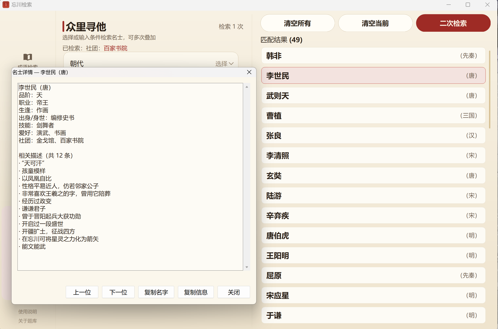
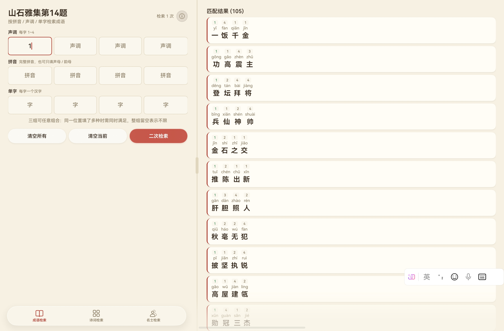
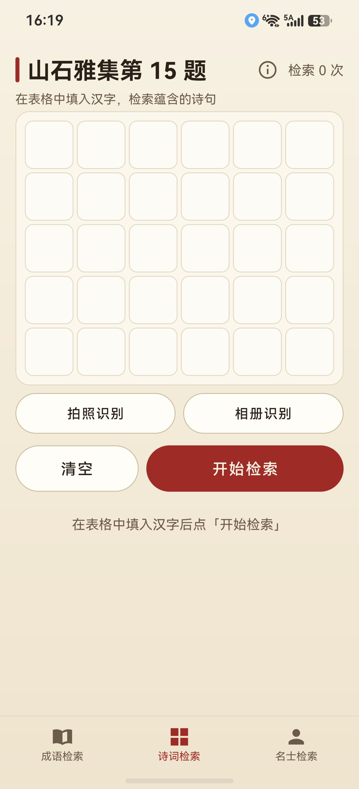
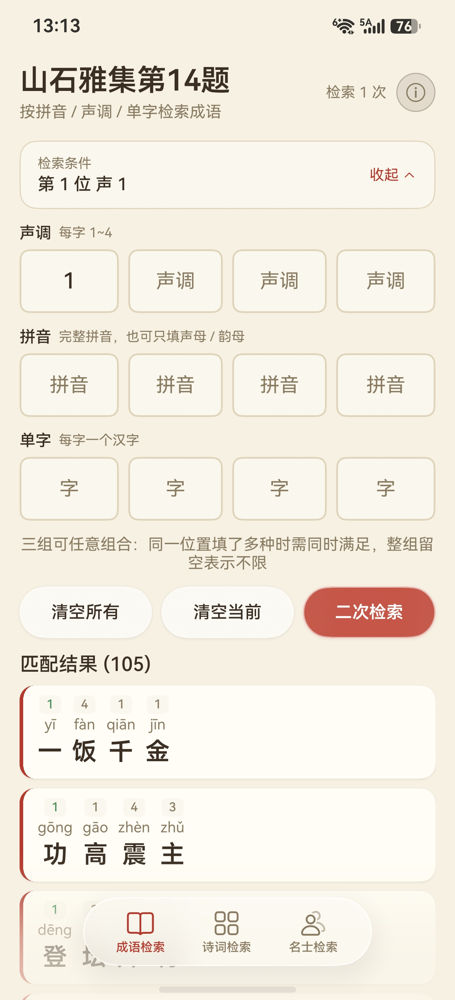

# 忘川检索（fhlSearch）

适用于《忘川风华录》**山石雅集第 14 题（成语检索）**、**第 15 题（诗词检索）** 和 **众里寻他活动（名士检索）**。

**当前版本：Windows 3.1.0 · Android 3.2 · HarmonyOS 3.2.3**

> 题库内嵌在程序里，**完全离线** —— 不联网、不收集任何数据。
> 非商业同人项目，与网易及《忘川风华录》官方无关联。

## 下载

**下载请移步至页面右侧 [Releases](../../releases)。**

三端各自独立发包，按你的设备取对应附件：

| 平台 | 附件 | 说明 |
| --- | --- | --- |
| Windows | `fhlSearch_v3.1.0.exe` | 双击即用，绿色免安装 |
| Android | `fhlSearch_v3.2.apk` | 传到手机 / 平板点一下安装 |
| HarmonyOS | `fhlSearch_v3.2.3.hap` | **未签名**，需要侧载，见下方「安装须知」 |

---

## 主要功能

题库内嵌在程序里，完全离线，用来快速定位三类检索题的答案：

- **成语检索**（山石雅集第 14 题）—— 319 条成语，按拼音 / 声调 / 单字查，命中位置标绿
- **诗词检索**（山石雅集第 15 题）—— 282 条五言诗句，6×5 字格填字，自动拼出能组成的诗句；
  **可从截图自动识别填格**（三端均支持）
- **名士检索**（众里寻他）—— 115 位名士，9 种条件（朝代 / 爱好 / 社团 / 品阶 / 职业 …）筛选

「检索」与「二次检索」是一对动作按钮：先在全库里查，出了结果之后就用「二次检索」
在上一批结果里接着筛，一层层缩小范围。

### 诗词检索「从图片识别」

不想一个个敲字，可以把**题目截图**直接丢进去，程序自动找出 6×5 字格、认出 30 个汉字
并自动开始检索。

| 平台 | 实现 | 系统要求 |
| --- | --- | --- |
| Windows | Windows 自带 OCR（`Windows.Media.Ocr`） | **Windows 10 (1809) 及以上** + 简体中文 OCR 组件 |
| Android | Google ML Kit 文字识别 | Android 10 及以上（中文识别模型已内嵌在 apk 里，无需联网下载） |
| HarmonyOS | 系统 Core Vision Kit 文字识别（`@kit.CoreVisionKit`） | HarmonyOS NEXT（API 24 / 6.1.1）；识别在本机完成、不联网 |

> 低版本系统上这个按钮会提示不可用，**其余功能完全不受影响**，汉字照样可以手打。

> ⚠️ **关于「众里寻他」**：「众里寻他」活动近期没有复刻，本题库依据的是旧版本的规则与
> 玩家整理的资料，**实际功能可能存在偏差或问题，当前仅供参考**。
> 后续相关活动正式上线后，会据此再作调整。

---

## 各平台特性

三端各自是一个完整工程、互不依赖，分别放在 [`Windows/`](Windows/)、[`Android/`](Android/)、[`Harmony/`](Harmony/) 下。

| | [Windows](Windows/) | [Android](Android/) | [HarmonyOS](Harmony/) |
| --- | --- | --- | --- |
| 技术栈 | C# / WinForms（.NET Framework 4.0） | Kotlin | ArkTS + ArkUI（Stage 模型） |
| 系统要求 | Windows 7 SP1 及以上 | Android 10（API 29）及以上 | HarmonyOS NEXT（API 24 / 6.1.1） |
| 适用设备 | 桌面 / 笔记本 | 手机、平板 | 手机、平板 |
| 安装包体积 | 0.30 MB | 44.32 MB | 1.52 MB |
| 联网与权限 | 不联网、不写注册表 | 不联网、**一个权限都不申请** | 不联网、仅用系统振动反馈 |
| 诗词识图 | 系统自带 OCR（需 Win10 1809+） | ML Kit（模型内嵌，无需下载） | 系统 Core Vision Kit（本机完成） |
| 布局 | 单窗口双栏 | 手机单栏 / 平板双栏 | 手机单栏 / 平板双栏 |
| 几处特色 | 纯 IL 的 AnyCPU，Win11 Arm 也能跑 | 成语三组 12 格同屏、结果逐字对齐；识图先裁后识 | 官方 HDS「沉浸光感」悬浮页签栏；识图先出裁剪框 |

三端共用同一套视觉规范（宣纸底 + 朱砂 + 描金），图标是自绘的朱砂圆印。
逐轮改动与验收数据见各目录下的 `CHANGELOG.md` 与 README。

---

## 效果截图

> 图片文件名里 `Demo` 后面的部分，就是该截图所用的**演示机型与操作系统**。

**PC · Windows 11 26H2**

| 平板 · Android 16 | 平板 · HarmonyOS 7.0.0.111 |
| --- | --- |
|  |  |

| 手机 · Android 16 | 手机 · HarmonyOS 7.0.0.111 |
| --- | --- |
|  |  |

更多截图与完整说明见 [`Windows/README.md`](Windows/README.md)、[`Android/README.md`](Android/README.md) 与 [`Harmony/README.md`](Harmony/README.md)。

---

## 安装须知

| 平台 | 怎么装 | 备注 |
| --- | --- | --- |
| Windows | 下载 exe，**双击就能用**。绿色免安装 —— 想放哪放哪，卸载直接删文件 | Win7 需要系统已装 .NET Framework 4.0+；Win10 / Win11 系统自带，开箱即用。不写注册表 |
| Android | 下载 apk 传到手机 / 平板，点一下安装（首次需在系统里允许「安装未知应用」） | 图标是朱砂圆印，名字叫「忘川检索」。不联网、不要任何权限 |

### HarmonyOS 版：未签名 hap 需要侧载

Windows 的 exe、Android 的 apk 都是双击 / 点一下就能装，**HarmonyOS 不一样**：
华为的安装包必须签名才能进入设备，而这里提供的是**未签名**的 hap，
直接传到手机上点开是装不上的，得借助工具**侧载**进去。前提有三条：

1. **准备一个华为开发者账号** —— 在[华为开发者官网](https://developer.huawei.com/)自行注册，
   并按页面指引完成开发者认证（免费）
2. **把手机 / 平板开启开发者模式** —— 设置 → 关于本机 → 连点「版本号」7 次，
   再到「开发者选项」里打开 **USB 调试**
3. **用侧载工具装进去** —— 用 **小白调试助手**、**DevEco Studio** 或同类工具连上设备，
   选中这个 hap 安装（工具会自行完成签名环节）

不想用第三方侧载工具的话，也可以按 [`Harmony/README.md`](Harmony/README.md) 里的方式，
在 DevEco Studio 中打开 [`Harmony/`](Harmony/) 工程、配置自动签名后直接运行。

---

## 开发工具与模型

本项目开发过程中用到的工具与模型：

- **工具**：DeepSeek Harness、Claude Code（VS Code）、DevEco Code、WorkBuddy、DevEco Studio、Android Studio、VMware
- **模型**：DeepSeek V4 Flash Vision Exp、DeepSeek V4 Pro、DeepSeek V4.1 Flash

---

## 许可

程序代码以 **MIT** 协议开源，见根目录 [`LICENSE`](LICENSE)。
各端另有一份，说明本端覆盖的目录：[`Windows/LICENSE`](Windows/LICENSE)、
[`Android/LICENSE`](Android/LICENSE)、[`Harmony/LICENSE`](Harmony/LICENSE)。

题库数据（`Windows/data/`、`Android/data/`、`Harmony/data/` 下的 Excel 与内嵌题库）**不在 MIT 授权范围内** ——
题库来源于微博 @蓝在寻，《忘川风华录》相关内容版权归网易所有。
详见 [`Windows/NOTICE.md`](Windows/NOTICE.md)、[`Android/NOTICE.md`](Android/NOTICE.md) 与 [`Harmony/NOTICE.md`](Harmony/NOTICE.md)。

本仓库是**非商业同人项目**，没有广告、赞助或任何收费入口。
**如权利人认为此处有不妥，请开 Issue 或联系作者，我会立即移除。**
