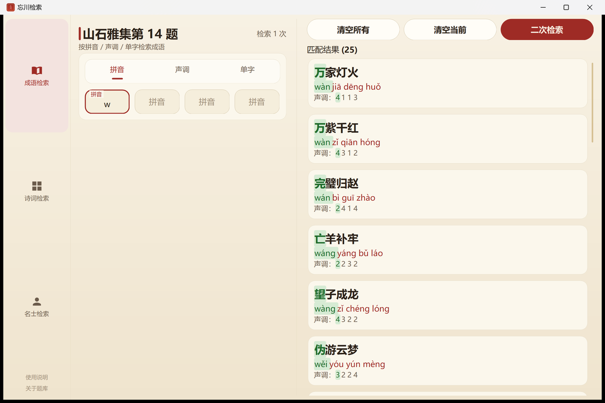
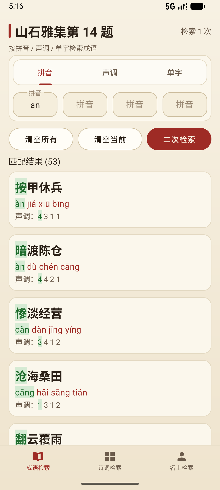

# 忘川检索 fhlSearch

《忘川风华录》「山石雅集」与「众里寻他」三类检索题的**离线查询小工具**。

按平台分目录存放，目前有：

| 平台 | 目录 | 说明 |
| --- | --- | --- |
| Windows | [`Windows/`](Windows/) | C# / WinForms，单个 exe 绿色免安装，支持 Windows 7 SP1 及以上 |
| Android | [`Android/`](Android/) | Kotlin，单个 apk 离线安装，支持 Android 10 及以上手机 / 平板 |
| HarmonyOS | [`Harmony/`](Harmony/) | ArkTS + ArkUI（Stage 模型），支持 HarmonyOS NEXT（API 24 / 6.1.1）手机与平板；提供**未签名** hap，**需侧载**（见下） |

---

## 下载

不想看代码的话，直接拿编译好的程序：

| 平台 | 下载 | 说明 |
| --- | --- | --- |
| Windows | **[`Windows/dist/fhlSearch.exe`](Windows/dist/fhlSearch.exe)** | 双击就能用。不联网、不写注册表、不需要安装。Win7 需要系统已装 .NET Framework 4.0+，Win10 / Win11 系统自带 |
| Android | **[`Android/dist/fhlSearch.apk`](Android/dist/fhlSearch.apk)** | 传到手机 / 平板点一下安装（需允许「安装未知应用」）。不联网、不要任何权限，Android 10 及以上 |
| HarmonyOS | **[`Harmony/dist/fhlSearch.hap`](Harmony/dist/fhlSearch.hap)**（**未签名**，约 1 MB） | **不能直接点开安装**，必须侧载（见下）。HarmonyOS NEXT（API 24 / 6.1.1）手机与平板 |

### HarmonyOS 版：未签名 hap 需要侧载

Windows 的 exe、Android 的 apk 都是双击/点一下就能装，**HarmonyOS 不一样**：
华为的安装包必须签名才能进入设备，而这里提供的是**未签名**的 hap，
直接传到手机上点开是装不上的，得借助工具**侧载**进去。前提有三条：

1. **准备一个华为开发者账号** —— 在[华为开发者官网](https://developer.huawei.com/)自行注册，并按页面指引完成开发者认证（免费）
2. **把手机 / 平板开启开发者模式** —— 设置 → 关于本机 → 连点「版本号」7 次，
   再到「开发者选项」里打开 **USB 调试**
3. **用侧载工具装进去** —— 用 **小白调试助手**、**DevEco Studio** 或同类工具连上设备，
   选中这个 hap 安装（工具会自行完成签名环节）

不想用第三方侧载工具的话，也可以按 [`Harmony/README.md`](Harmony/README.md) 里的方式，
在 DevEco Studio 中打开 [`Harmony/`](Harmony/) 工程、配置自动签名后直接运行。

| Windows 版 | Android 版 | HarmonyOS 版 |
| --- | --- | --- |
|  |  |  |

---

## 它做什么

题库内嵌在程序里，完全离线，用来快速定位三类检索题的答案：

- **成语检索**（山石雅集第 14 题）—— 319 条成语，按拼音 / 声调 / 单字查，命中位置标绿
- **诗词检索**（山石雅集第 15 题）—— 282 条五言诗句，6×5 字格填字，自动拼出能组成的诗句
- **名士检索**（众里寻他）—— 115 位名士，9 种条件（朝代 / 爱好 / 社团 / 品阶 / 职业 …）筛选

「检索」与「二次检索」是一对动作按钮：先在全库里查，出了结果之后就用「二次检索」
在上一批结果里接着筛，一层层缩小范围。

> ⚠️ **关于「众里寻他」**：「众里寻他」活动近期没有复刻，本题库依据的是旧版本的规则与
> 玩家整理的资料，**实际功能可能存在偏差或问题，当前仅供参考**。
> 后续相关活动正式上线后，会据此再作调整。

更多截图和完整说明见 [`Windows/README.md`](Windows/README.md)、[`Android/README.md`](Android/README.md) 与 [`Harmony/README.md`](Harmony/README.md)。

---

## 开发工具与模型

本项目开发过程中用到的工具与模型：

- **工具**：DeepSeek Harness、Claude Code（VS Code）、DevEco Code、WorkBuddy、DevEco Studio、Android Studio、VMware
- **模型**：DeepSeek V4 Flash Vision Exp、DeepSeek V4 Pro、DeepSeek V4.1 Flash

---

## 许可

程序代码以 **MIT** 协议开源，见根目录 [`LICENSE`](LICENSE)。
各端另有一份，说明本端覆盖的目录：[`Windows/LICENSE`](Windows/LICENSE)、
[`Android/LICENSE`](Android/LICENSE)、[`Harmony/LICENSE`](Harmony/LICENSE)。

题库数据（`Windows/data/`、`Android/data/`、`Harmony/data/` 下的 Excel 与内嵌题库）**不在 MIT 授权范围内** ——
题库来源于微博 @蓝在寻，《忘川风华录》相关内容版权归网易所有。
详见 [`Windows/NOTICE.md`](Windows/NOTICE.md)、[`Android/NOTICE.md`](Android/NOTICE.md) 与 [`Harmony/NOTICE.md`](Harmony/NOTICE.md)。

本仓库是**非商业同人项目**，没有广告、赞助或任何收费入口。
**如权利人认为此处有不妥，请开 Issue 或联系作者，我会立即移除。**
