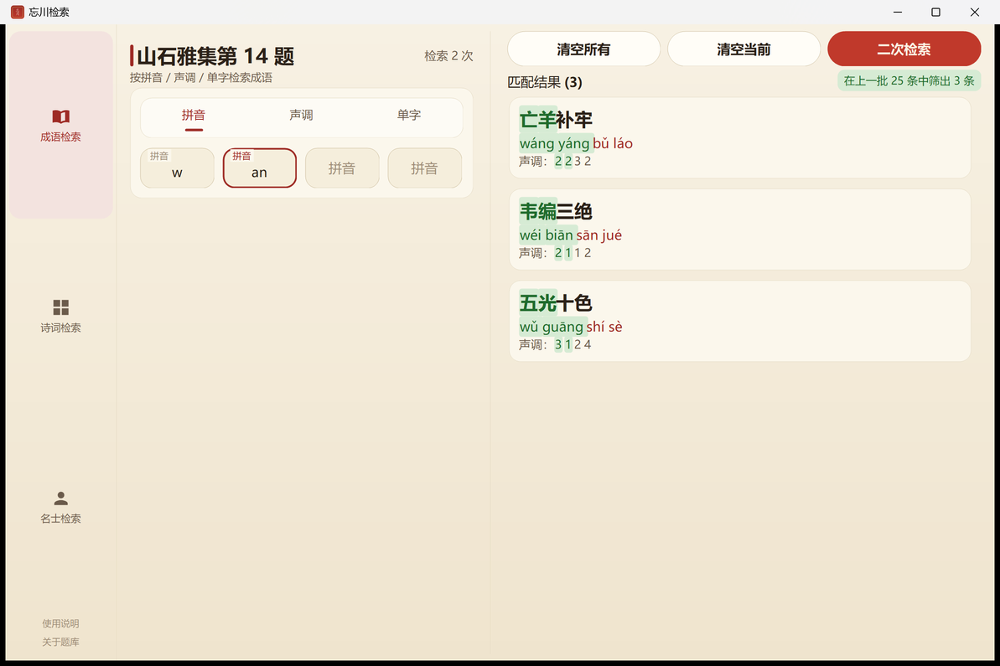
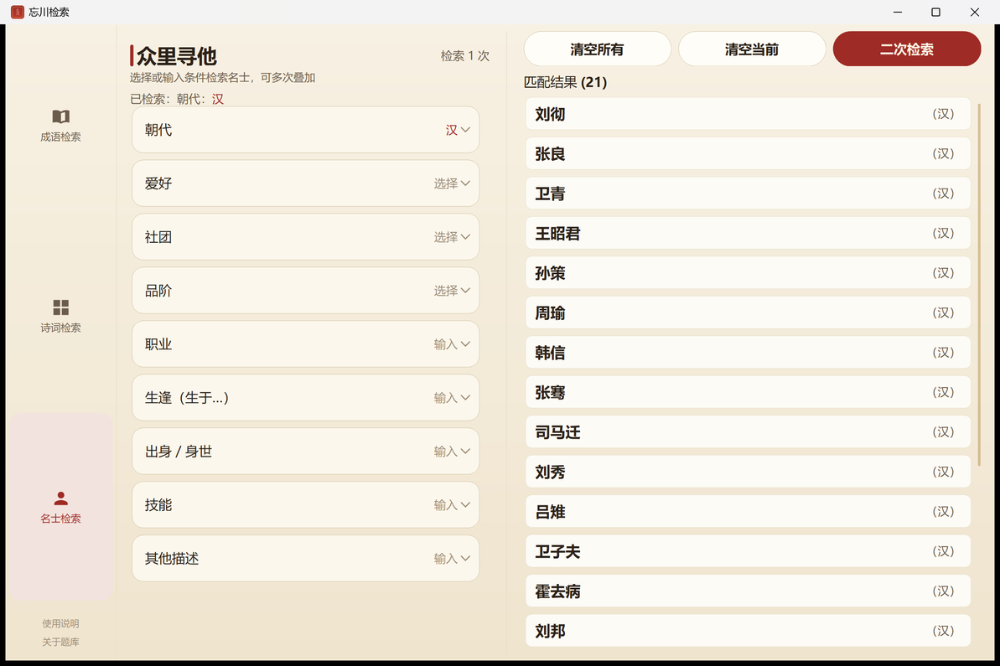
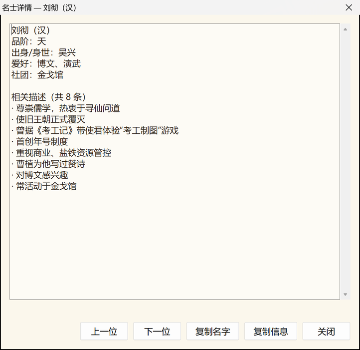

# 忘川检索 fhlSearch · Windows 版

《忘川风华录》「山石雅集」与「众里寻他」三类检索题的**离线查询小工具**。

**单个 exe，绿色免安装，不联网、不写注册表，支持 Windows 7 SP1 及以上。**

> 非商业同人工具，仅供个人学习交流。与网易及《忘川风华录》官方无关联。

界面与安卓版《忘川检索》共用同一套设计规范（宣纸底 + 朱砂 + 描金）。


---

## 快速开始

直接下载 [`dist/忘川检索.exe`](dist/忘川检索.exe) 双击运行即可，不需要安装任何东西。

> Win7 需要系统已装 .NET Framework 4.0+；Win10 / Win11 系统自带，开箱即用。

---

## 三大模块

| 模块 | 大标题 | 内容 |
| --- | --- | --- |
| 成语检索 | 山石雅集第 14 题 | 319 条成语，拼音 / 声调 / 单字三种模式 + 层级二次检索 |
| 诗词检索 | 山石雅集第 15 题 | 282 条五言诗句，6×5 字格选字成诗 |
| 名士检索 | 众里寻他 | 115 位名士，9 种检索条件（滚轮选择 / 模糊输入）+ 检索次数计数 |

「检索」与「二次检索」是一对动作按钮，同一时间只显示一个：

- **检索** —— 在全部数据里找（还没有上一批结果时显示）
- **二次检索** —— 在上一次的结果里接着筛（有了上一批结果时显示）

点「清空所有」，或用「清空当前」退到最初那一层，「检索」会自动回来。

| 二次检索 | 诗词字格 |
| --- | --- |
|  |  |

| 名士检索 | 名士详情 |
| --- | --- |
|  |  |

详细用法见 [`docs/使用说明.md`](docs/使用说明.md)，版本变更见 [`CHANGELOG.md`](CHANGELOG.md)。

---

## 目录结构

```
├── dist/                        发布产物
│   ├── 忘川检索.exe             ← 单文件绿色程序
│   └── 使用说明.txt             由 docs/使用说明.md 自动生成
├── data/                        题库源文件（三个 Excel）
├── 重新生成题库.bat             改完题库后双击这个
├── docs/
│   ├── 需求梳理.md / .html      需求与方案（含已确认的决策）
│   ├── 使用说明.md
│   ├── 技术说明.md              架构、编码约定、验证方法
│   └── screenshots/             README 用的截图
├── src/FhlSearch/               源码（C# / .NET Framework 4.0 / WinForms）
│   ├── Program.cs               入口、全局异常处理、--selftest
│   ├── MainForm.cs              主窗口外壳：宣纸底 + 左侧三格导航 + 分栏
│   ├── Dbg.cs                   调试日志（仅 --debug 时生效）
│   ├── SelfTest.cs              离线自测（算法对拍用）
│   ├── Theme/
│   │   ├── Ui.cs                配色板、DPI 缩放、字体回退（与安卓 colors/dimens 对齐）
│   │   ├── Painting.cs          绘制基元 + 极简 SVG path 解析（复用安卓的图标路径）
│   │   ├── Widgets.cs           自绘控件（按钮/输入框/选项卡/导航/滚动列表/条件行）
│   │   └── WheelRouter.cs       应用级滚轮路由（滚轮跟着光标走）
│   ├── Data/
│   │   ├── Bank.cs              内嵌题库解析 + 三大检索算法
│   │   └── PinyinTone.cs        无声调拼音 + 数字声调 → 带调拼音
│   ├── Modules/
│   │   ├── IdiomModule.cs       模块一：成语检索
│   │   ├── PoemModule.cs        模块二：诗词检索（含 6×5 字格控件）
│   │   ├── PersonModule.cs      模块三：名士检索
│   │   ├── PersonInfoView.cs    名士详情的排版与绘制
│   │   └── Dialogs.cs           标准 Windows 对话框（选择/输入/详情/说明）
│   └── Resources/
│       ├── bank.txt             由 xlsx 生成的内嵌题库（勿手改）
│       └── app.ico              程序图标（朱砂方印）
└── tools/                       开发与验证工具（Python / PowerShell）
    ├── build_data.py            xlsx → bank.txt
    ├── make_dist.py             打包到 dist/
    ├── make_icon.py             生成图标
    ├── ref_check.py             检索规则的 Python 参考实现（对拍用）
    ├── diff_check.py            两套实现结果比对
    ├── shot.ps1                 自动化截图 + UI 交互测试
    ├── bom.py / md2html.py / crop.py 等辅助脚本
    └── oneoff/                  一次性修复脚本（已跑完，留档）
```

---

## 开发环境

- **.NET SDK 8**（编译 `net40` 目标，参考程序集由 `Microsoft.NETFramework.ReferenceAssemblies` NuGet 包提供）
- **Python 3**（数据管道与验证工具，依赖 `openpyxl`、`Pillow`）

```bat
:: 编译
dotnet build src\FhlSearch\FhlSearch.csproj -c Release

:: 打包到 dist\
python tools\make_dist.py

:: 题库 → 编译 → 打包，一条龙（也可以直接双击 重新生成题库.bat）
python tools\build_data.py && dotnet build src\FhlSearch\FhlSearch.csproj -c Release && python tools\make_dist.py
```

---

## 题库

题库是三个 Excel，放在 `data/`：

| 文件 | 内容 |
| --- | --- |
| `成语检索.xlsx` | 319 条成语（成语 + 4 个拼音 + 4 个声调） |
| `诗词检索.xlsx` | 282 条五言诗句（诗句 + 诗名 + 作者） |
| `名士检索.xlsx` | 115 位名士（朝代/品阶/职业/生逢/出身/技能/爱好/社团/描述） |

改完双击根目录的 `重新生成题库.bat`，新的 `dist\忘川检索.exe` 就出来了。

> 题库目录默认取项目里的 `data/`；想放到别处，在项目根目录建一个 `bank_src.txt`
> 写上一行目录路径即可（该文件不会被提交）。

**题库来源**：题库来源于微博 **@蓝在寻**（原整理者），本仓库只做了格式转换，
不对这部分内容主张任何权利；详见 [`NOTICE.md`](NOTICE.md)。

程序**不包含任何游戏美术 / 音频 / 立绘资源**，只有检索用的纯文本条目。

---

## 版权与免责

- 这是一个**非商业同人工具**，仅供个人学习、研究与交流使用，**没有广告、赞助或任何收费入口**。
- 《忘川风华录》及其全部游戏内容、名词、角色、设定、文本，版权归 **网易（NetEase）** 所有。
- 程序代码按 MIT 协议开源；**题库数据不在 MIT 覆盖范围内**，见 [`NOTICE.md`](NOTICE.md)。
- 题库由第三方整理，可能存在错漏，不保证与游戏内实际内容一致。
- **如果权利人认为本仓库或本程序有不妥之处，请开一个 [Issue](../../issues) 或联系作者，
  我会在收到通知后立即核实并移除，无需事先协商。**
- 请支持正版游戏。

---

## 验证方式

这个项目用**两套独立实现交叉对拍**来保证检索规则正确：

- `src/FhlSearch/Data/Bank.cs` —— 程序实际使用的 C# 实现（读内嵌题库）
- `tools/ref_check.py` —— Python 参考实现（**直接读原始 xlsx**，不经过内嵌题库）

```bat
python tools\ref_check.py gen _dev\queries.txt                    :: 生成检索用例
python tools\ref_check.py run _dev\queries.txt _dev\out_python.txt
忘川检索.exe --selftest _dev\queries.txt _dev\out_csharp.txt
python tools\diff_check.py                                        :: 逐条比对
```

当前状态：**215 条用例（成语三模式 + 层级二次检索 + 诗词字格 + 名士 9 种条件）结果完全一致**。

UI 侧再用 `tools/shot.ps1` 驱动真实程序截图 + 读调试日志核对状态：

```bat
powershell -ExecutionPolicy Bypass -File tools\shot.ps1 ^
    -Exe dist\忘川检索.exe -Out _dev\shot.png -AppDebug ^
    -Script "click:5,5|click:429,380|paste:w|click:738,475|wait:1200"
```

---

## 编码约定（踩过坑，务必遵守）

| 文件类型 | 编码 | 原因 |
| --- | --- | --- |
| `.cs` | UTF-8（无 BOM 也可以） | Roslyn 会按 UTF-8 严格解码 |
| `.ps1` | **UTF-8 with BOM** | Windows PowerShell 5.1 无 BOM 时按 GBK 解码，中文注释会破坏语法 |
| `.bat` | **GBK / cp936** | cmd.exe 按系统 OEM 代码页读取批处理 |
| `.txt`（给用户看） | **UTF-8 with BOM** | Win7 记事本无 BOM 时会当 ANSI 解，中文乱码 |
| Python 脚本标准输出 | 跟随系统编码 | 强制 UTF-8 会让 cmd 控制台显示乱码 |

`tools/bom.py` 可以给 `.ps1` 补 BOM。

---

## 许可

代码以 MIT 协议开源，详见 [LICENSE](LICENSE)；
**题库数据不在 MIT 授权范围内**，版权归其整理者，详见 [NOTICE.md](NOTICE.md)。
