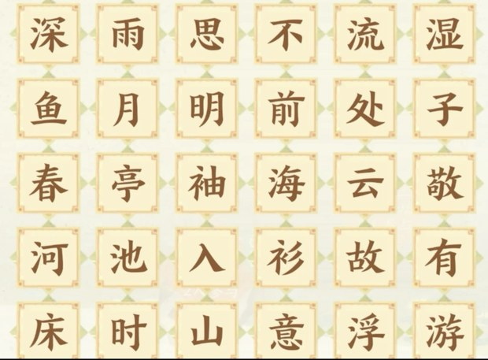

# 忘川检索 fhlSearch · 使用说明

版本 1.1 ｜ 适用于 Windows 7 SP1 及以上

---

## 一、这是什么

一个离线的《忘川风华录》检索小工具，用来快速查「山石雅集」和「众里寻他」三类题目的答案。
纯绿色免安装：**只有一个 exe 文件，双击就能用**，不写注册表、不产生垃圾文件、不需要装 Office。

题库数据已经**内嵌在 exe 里面**，拷到任何电脑上都能直接跑。

界面用的是宣纸底 + 朱砂 + 描金的配色，与安卓版《忘川检索》完全一致。

---

## 二、运行环境

| 系统 | 说明 |
| --- | --- |
| Windows 10 / 11 | 双击直接运行，什么都不用装 |
| Windows 8 / 8.1 | 双击直接运行 |
| Windows 7 SP1 | 需要系统已安装 **.NET Framework 4.0 或更高**（打过 Windows 更新的电脑基本都有）。如果提示缺少 .NET，去微软官网搜「.NET Framework 4.8 离线安装包」装一次即可，免费。 |
| **Windows on Arm**（骁龙本 / Arm 平板） | **Windows 11 Arm 版可以直接运行**（原生 Arm64 或系统自动仿真，不用你操心）。Windows 10 Arm 版不保证，见下方说明。 |

支持 32 位和 64 位系统。屏幕缩放（125% / 150% / 200%）已做适配，不会模糊或错位。

**关于 Windows on Arm**

- 程序是纯 .NET 程序，**本身不含任何 x86/x64 机器码**，所以在 Arm 上要么由 .NET 直接编译成 Arm64 原生运行，
  要么由 Windows 11 自带的仿真层跑，两种都能用。
- **Windows 11 Arm 版**：可以跑。.NET Framework 4.8.1 起原生支持 Arm64，系统装的版本够新就是原生运行，更快；
  版本旧一点则由 Windows 11 的 x64 仿真运行，也能用。
- **Windows 10 Arm 版**：**不保证**。Windows 10 Arm 只支持 x86 仿真、没有 x64 仿真，
  本程序是 64 位优先的，可能起不来。真要在 Win10 Arm 上用，建议先按下面的方法试一下。
- 屏幕缩放、字体、DPI 在 Arm 笔记本上同样有效；如果系统里没有微软雅黑，程序会自动换成别的中文字体。
- 「从图片识别」在 Arm 上同样需要 Windows 10 (1809)+ 与简体中文 OCR 组件，要求与普通电脑一致。

> 想自己确认一下能不能跑：双击 exe，三个模块各检索一次、再点「关于题库」看一眼版本号即可。
> 也可以用任务管理器看这个进程标注的是 **ARM64**（原生）还是 **x64**（仿真）—— 两种都算正常。

---

## 三、界面总览

```
┌────────┬──────────────────────────┬──────────────────────────┐
│ 成语检索│  ▍山石雅集第 14 题  检索 0 次│  填写检索条件后点「检索」  │
│        │  按拼音 / 声调 / 单字…      │                          │
│ 诗词检索│  ┌────────────────────┐  │                          │
│        │  │ 拼音 │ 声调 │ 单字  │  │                          │
│        │  │ □□□□              │  │                          │
│        │  └────────────────────┘  │                          │
│ 名士检索│  ┌────────────────────┐  │                          │
│        │  │       检  索        │  │                          │
└────────┴──────────────────────────┴──────────────────────────┘
```

（上图是刚打开时的样子：左栏底部是「检索」键，右栏还没有结果。
点过「检索」出结果后，「检索」收起，右上角出现「清空所有 / 清空当前 / 二次检索」。）

- **左侧竖栏**切换三个模块：**成语检索 / 诗词检索 / 名士检索**（选中项是朱砂淡底块）
- **左半边**是检索条件，**右半边**是检索结果，中间一条细分隔线
- 右上角「**检索 N 次**」是本次运行累计的检索次数，只有点「清空所有」才归零
- **鼠标滚轮跟着光标走**：光标停在哪个可滚动的区域上，滚的就是哪个，不用先点一下
- 窗口可自由缩放，内容会跟着重新排布

---

## 四、三大模块

### 1. 成语检索（山石雅集第 14 题）

题库 319 条成语。上方三个选项卡切换检索方式，下面 4 个输入框分别对应成语的第 1～4 个字：

- **拼音**：填英文字母。可以填完整拼音，也可以只填声母或韵母（模糊匹配）。
  - 填 `zh` → 命中 zhu / zhong / zhen …
  - 填 `ang` → 命中 cang / chang / shang …
  - 填 `an` → 命中 an / cang / chan …
- **声调**：填 `1` `2` `3` `4`
- **单字**：每格填一个汉字

**留空的输入框表示这一位不限。** 不用把 4 格都填满。

切换选项卡时，**每种方式各自记住自己填过的内容**，切回去还在。

按要求填好后点「**检索**」按钮，或者直接按 Enter。

结果是一张张三行卡片：**成语 ／ 带调拼音 ／ 声调：数字**。
**你填了条件的那几位会用绿色标出来**（汉字、拼音、声调三处同时标绿）。

**层级检索**：第一次检索是在全部 319 条里找；出结果后，改条件再点「检索」，就是**在当前结果里继续缩小范围**。
处于"继续筛"状态时，「匹配结果」右边会挂一个绿色小标签「二次检索中 · 当前范围：N 条」。

结果区上方三个按钮：

| 按钮 | 作用 |
| --- | --- |
| 清空所有 | 全部归零（含检索次数与输入框），回到初始状态 |
| 清空当前 | 退回上一级结果，并把输入框恢复成上一级当时的样子 |
| 二次检索 | **在上一次的检索结果里**按当前条件再检索一遍 |

**「检索」和「二次检索」是一对动作按钮，同一时间只出现一个**，区别只在*在哪个范围里找*：

- **检索** → 在全部 319 条成语里找（还没有上一批结果时显示）
- **二次检索** → 在上一次的结果（也就是右边现在显示的这批）里找（有了上一批结果时显示）

日常用法：第 1 格填 `w` → 点「检索」→ 出来 25 条，太多 —— 这时「检索」自动收起、「二次检索」出现 →
第 2 格再填 `an` → 点「二次检索」，就会在这 25 条里接着筛。
结果区右上角会提示「**在上一批 25 条中筛出 3 条**」，一眼看得出这次是在哪个范围里找的。
**你填过的内容一直都在**，随时可以用「清空当前」退回上一级。

> 「检索」什么时候回来？回到初始状态时自动恢复：点「清空所有」，或用「清空当前」一路退到最初那一层。
> 另外**一次都没筛出结果**（0 条）时也会显示「检索」，免得条件写错了没法直接重搜。

### 2. 诗词检索（山石雅集第 15 题）

题库 282 条五言诗句。

- 在 **6 列 × 5 行 = 30 格** 的字格里，每格填一个汉字
- **方向键** ↑ ↓ ← → 移动格子，当前格显示**朱砂方框**
- 鼠标点击也能选格子
- 填完一个字会自动跳到下一格，方便连续输入；在空格上按 `Backspace` 会退回上一格
- 每格只认第一个汉字

下方三个按钮：「**从图片识别**」把题目截图里的字自动填进字格；「**清空**」清掉字格和结果；「**开始检索**」开始匹配。

程序会找出**能由格中字拼出的所有诗句**（每个字用一个格子；诗句里有重复字，格子里就要有两个相同的字）。
**诗句的先后顺序和字格里的排列无关。**

- 命中的格子变成**绿色**，右上角一个小圆圈数字 ①②③④⑤ 表示这个字在诗句里的第几位
- 右侧列出：诗句 ·《诗词名》· 作者
- 命中多条时点哪一条，字格上就高亮哪一组（默认高亮第一条）
- 改动字格内容会自动清掉上一次的结果与标亮

> 该模块没有层级检索，所以结果区只有「清空所有 / 清空当前」两个键。
> 其中「清空当前」只清结果、保留字格。

#### 从图片识别（OCR）

懒得到格子里一个个敲字，可以直接把**游戏题目的截图**丢进来：

1. 点「**从图片识别**」→ 选一张图片（`png` / `jpg` / `jpeg` / `bmp` / `gif` / `tif`）
2. 程序自动找到图里的 6×5 字格，识别出 30 个汉字并填进格子
3. 填完**立刻自动检索**，直接看右边结果

能认出来的情况：

- 手机整屏截图、只截题目区域都行；上下有黑边、带状态栏也没关系（会自动裁掉）
- 图片会**自动缩放到合适尺寸**再识别，不用自己裁

> **系统要求**：这条功能用的是 Windows **自带**的文字识别，需要
> **Windows 10 (1809 版 / build 17763) 及以上**，并且系统里装了**简体中文的 OCR 组件**
> （中文版 Win10/11 一般默认就有）。
> 在 Windows 7 / 8 / 8.1 上这条功能用不了，会弹提示告诉你怎么回事；
> **其余功能完全不受影响**，汉字照样可以手动输入。

万一某个字认错了（字体太花、截图太糊），**直接在格子里改就行** —— 识别只是帮你省掉打字，
填完照样点「开始检索」即可。

#### 识别不准时怎么办

如果认出来的字不对、或者程序提示「**拼不出题库里的诗句**」，按这两步就能补救：

1. 对着截图看一眼字格，把认错的字**直接改掉**（格子里本来就是可以打字的）
2. 再点「**开始检索**」

程序只负责"认字"，最终结果永远按格子里实际的字来算，所以**手改一定生效**。

#### 截图建议（照着做，识别率最高）



上面这张就是一张**理想输入**：整个 6×5 字格完整、连边框一起截进来、字够大够清晰。

| 建议 | 说明 |
| --- | --- |
| **字格要完整** | 6 列 × 5 行一个角落都不能缺，不能被弹窗、按钮挡住 |
| **连边框一起截** | 字格外留一点余量最好；周围多截一些别的界面也没关系，程序会自动裁 |
| **可以带黑边 / 状态栏** | 长截图上下的大片黑边、手机状态栏都不影响，会自动裁掉 |
| **别用缩略图** | 图片长边建议 ≥ 800 像素；格子里每个字实际不到 40 像素时识别率会明显下降 |
| **别用二次压缩的图** | 微信 / QQ 转发过的图片会被压糊，尽量发原图 |
| **深浅底都行** | 深色格子配浅色字也能认（程序会按每个格子自己的底色判深浅） |
| **避免反光和透视** | 拍屏幕的照片如果反光严重、角度很斜，识别率会掉 —— 能截图就别拍屏 |

> 一句话总结：**截图 > 拍屏，原图 > 转发图，大字 > 小字。**
>
> 顺便说：识别只是个加速器，**认错了随手改一个字就行**，不会因为认错就卡住。

### 3. 名士检索（众里寻他）

题库 115 位名士。左边竖排 **9 个条件**，点任意一行来设置：

| 条件 | 形式 |
| --- | --- |
| 朝代（15 项） | 滚轮选择 |
| 爱好（10 项） | 滚轮选择 |
| 社团（9 项） | 滚轮选择 |
| 品阶（天 / 地 / 玄） | 滚轮选择 |
| 职业 | 输入（模糊检索） |
| 生逢（生于…） | 输入（模糊检索） |
| 出身 / 身世 | 输入（模糊检索） |
| 技能 | 输入（模糊检索） |
| 其他描述 | 输入（模糊检索，查描述 1–15 列） |

- 点条件行 → 打开标准 Windows 对话框。**选项型的**是一个列表，鼠标点选或双击直接确定；
  **输入型的**是一个文本框，打完字点「确定」。两种对话框都有「清除该条件」和「取消」
- 设好值的条件，行右侧会显示**朱砂色的值**；没设的显示灰色的「选择」/「输入」
- 标题下方一行「**已检索：**朝代：汉」汇总当前用到的条件，值用朱砂色
- **条件可以叠加**：设好几个条件后一起点「检索」，是"并且"的关系
- 文本条件是**模糊检索**：自动忽略标点和空格，不拆分检索词
  - 搜 `乱世` → 命中「乱世」「生于乱世」「乱世/王朝更迭」
  - 搜 `乱 世` → 去空格后等同 `乱世`
- **「检索」按钮在左栏底部**；出了结果之后它会自动收起、把位置让给结果区的「二次检索」

**「检索」和「二次检索」同样是一对动作按钮，同一时间只出现一个**，区别只在*在哪个范围里找*：

- **检索** → 在全部 115 位名士里找（还没有上一批结果时显示）
- **二次检索** → 在上一次的结果（右边现在显示的这批）里找（有了上一批结果时显示）

日常用法：朝代选「汉」→ 点「检索」→ 出来 21 位 —— 这时「检索」自动收起、「二次检索」出现 →
再选「爱好 = 博文」→ 点「二次检索」→ 在这 21 位里筛出 4 位，右上角提示「**在上一批 21 位中筛出 4 位**」。
**已选的条件一直都在**，随时可以用「清空当前」退回上一级。

> 「检索」什么时候回来？回到初始状态时自动恢复：点「清空所有」，或用「清空当前」一路退到最初那一层。
> 另外**一次都没筛出结果**（0 条）时也会显示「检索」，免得条件写错了没法直接重搜。

结果区：

| 结果情况 | 按钮 |
| --- | --- |
| 1 条及以上 | 清空所有 · 清空当前 · 二次检索 |
| 0 条 | 提示「未检索到该名士」+ 清空所有 · 清空当前 |

结果每行是「**名士** …（朝代）」，朝代靠右。

**点结果里的任意一行，会弹出该名士的全部信息**：

- 名士（朝代）
- 品阶 / 职业 / 生逢 / 出身·身世 / 技能 / 爱好 / 社团（题库里没填的不显示）
- **相关描述（共 N 条）**：每条一行，前缀「· 」

详情对话框里的操作：

| 操作 | 说明 |
| --- | --- |
| `上一位` / `下一位` 按钮 | 不用关窗口，直接在候选之间翻看 |
| `复制名字` | 复制名士名字 |
| `复制信息` | 把该名士所有字段复制到剪贴板 |
| 文本框内滚轮 / 方向键 / PgUp PgDn | 滚动详情内容 |
| `关闭` 按钮、**Esc**、右上角 **✕** | 关闭对话框 |
| 拖动标题栏 | 移动对话框位置 |

> 三个对话框（选条件 / 输条件 / 名士详情）以及「使用说明」「关于题库」都是**标准 Windows 对话框**：
> 有自己的标题栏和关闭按钮、可以拖动、居中于主窗口，按 Esc 关闭。
> 打开期间主窗口会被锁定（这是 Windows 模态对话框的正常行为）。

- 点「清空当前」会退回上一级结果，**并把你这一层用过的条件标记复位**（值还留着，方便重新筛）
- 「检索 N 次」只在点「清空所有」时归零

---

## 五、快捷键

| 按键 | 作用 |
| --- | --- |
| Enter | 执行检索 / 对话框里点「确定」 |
| Esc | 关闭对话框 |
| ↑ ↓ ← → | 移动选择（诗词字格、结果列表、对话框里的列表） |
| PgUp PgDn | 滚动结果列表 / 详情 |
| 滚轮 | 滚动光标底下那一块（条件列表、结果列表、详情文本框） |
| Tab | 在控件之间移动 |

---

## 六、常见问题

**Q：双击没反应 / 提示缺少 .NET？**
A：这台电脑是 Windows 7 且没装 .NET Framework。去微软官网下载「.NET Framework 4.8」安装一次即可。

**Q：提示「非法字符」？**
A：输入框只接受规定的字符——拼音只收英文字母，声调只收 1–4，单字和字格只收汉字。

**Q：诗词检索明明字都在，为什么没找到？**
A：诗句必须是题库里有的 282 条之一；而且诗句里的每个字都要在格子里有对应格子（重复字需要两个格子）。

**Q：名士检索选了「辽」没有结果？**
A：题库里目前确实没有辽代名士，这是正常的。

**Q：想改题库怎么办？**
A：改 `data\` 下的三个 Excel，然后双击项目根目录的 **`重新生成题库.bat`**，会自动重新生成 exe。

---

## 七、题库来源

| 模块 | 题库文件 | 条数 |
| --- | --- | --- |
| 成语检索 | 成语检索.xlsx（Sheet1） | 319 |
| 诗词检索 | 诗词检索.xlsx（择字成诗） | 282 |
| 名士检索 | 名士检索.xlsx（众里寻他） | 115 |

题库数据在编译时被转换并压缩进 exe，运行时**完全不读取 Excel**。
